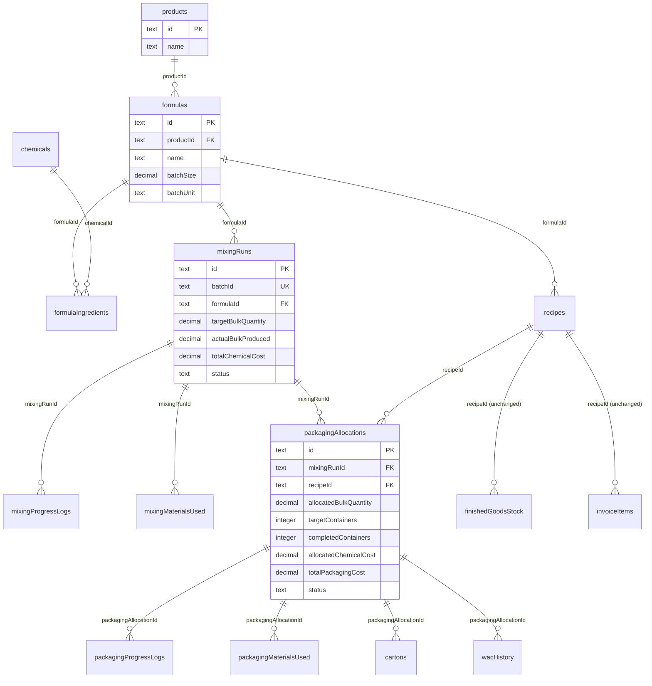

# Two-Phase Production System — Revised Design (v2)

## Problem

The current production system couples chemical mixing and container packaging into a single monolithic `productionRuns` entity. The client needs to:

1. Mix a bulk batch of chemicals (e.g., 500kg detergent powder)
2. Track actual yield independently (often under target, e.g., 450kg)
3. Package the produced bulk across **multiple packaging formats** from one screen
4. Maintain strict per-batch traceability (lab reports attach to the chemical batch)
5. Track leftover unpackaged bulk on the factory floor

---

## Resolved Decisions

| Decision | Resolution |
|---|---|
| Batch ID format | Continue existing `A0001, A0002...` series — shared sequence across legacy and new mixing runs |
| Legacy coexistence | **Immediately replaced.** Old monolithic production UI is removed. Legacy data stays in DB but is view-only. |
| Formula scope | Each formula is tied to **one product** (`productId` FK on formulas) |
| Batch multiplier | **Removed entirely.** 1 mixing run = 1 batch. No `batchesProduced` field. `targetBulkQuantity = formula.batchSize` always. |
| Mixing auto-complete | Yes — auto-complete when `actualBulkProduced ≥ targetBulkQuantity` |
| Packaging model | Multiple **packaging allocations** per mixing run. Operator sees all allocations on one screen, selects which one to log against. |

---

## Proposed Changes

### Data Model — New Tables (8)

---

#### [NEW] `formulas`

Pure chemical formula definitions, scoped to one product.

| Column | Type | Constraints | Purpose |
|---|---|---|---|
| `id` | text | PK (cuid2) | |
| `productId` | text | NOT NULL, FK → products.id | **One formula per product** |
| `name` | text | NOT NULL | e.g., "Dishwash Powder Base Formula" |
| `batchSize` | decimal(10,2) | NOT NULL | Standard batch volume/mass (e.g., 500.00) |
| `batchUnit` | text | NOT NULL, default "kg" | "kg" or "liters" |
| `estimatedIngredientsCost` | decimal(12,2) | nullable | Computed sum of chemical costs |
| `minBatchYield` | decimal(5,2) | nullable | Minimum acceptable yield % |
| `productionInstructions` | text | nullable | Mixing SOP / procedure steps |
| `notes` | text | nullable | |
| `isActive` | boolean | NOT NULL, default true | Soft delete flag |
| `createdAt` | timestamp | NOT NULL, default now() | |
| `updatedAt` | timestamp | NOT NULL, auto-update | |

---

#### [NEW] `formulaIngredients`

Chemical BOM for one batch.

| Column | Type | Constraints | Purpose |
|---|---|---|---|
| `id` | text | PK (cuid2) | |
| `formulaId` | text | FK → formulas.id (CASCADE) | Parent formula |
| `chemicalId` | text | FK → chemicals.id | Raw chemical |
| `quantityPerBatch` | decimal(10,3) | NOT NULL | Qty needed per batch |
| `createdAt` | timestamp | NOT NULL | |
| `updatedAt` | timestamp | NOT NULL | |

Index: `formula_ingredients_formula_idx` on `(formulaId)`.

---

#### [NEW] `mixingRuns`

Phase 1: Chemical compounding. 1 run = 1 batch, always.

| Column | Type | Constraints | Purpose |
|---|---|---|---|
| `id` | text | PK (cuid2) | |
| `batchId` | text | NOT NULL, UNIQUE | Sequential code from shared series (A0001, A0002...) |
| `formulaId` | text | FK → formulas.id | Chemical formula |
| `warehouseId` | text | FK → warehouses.id | Factory floor warehouse |
| `operatorId` | text | FK → user.id | Mixing operator |
| `initiatorId` | text | nullable, FK → user.id | Who created the run |
| `targetBulkQuantity` | decimal(12,3) | NOT NULL | = formula.batchSize (always) |
| `actualBulkProduced` | decimal(12,3) | default "0" | Running total from progress logs |
| `bulkUnit` | text | NOT NULL | "kg" or "liters" |
| `totalChemicalCost` | decimal(12,2) | default "0" | Sum of all chemical deductions |
| `chemicalCostPerUnit` | decimal(10,4) | default "0" | totalChemicalCost / actualBulkProduced |
| `status` | text | NOT NULL, default "scheduled" | scheduled → in_progress → completed / failed / cancelled |
| `scheduledStartDate` | timestamp | nullable | |
| `actualStartDate` | timestamp | nullable | |
| `actualCompletionDate` | timestamp | nullable | |
| `yieldPercentage` | decimal(5,2) | nullable | (actualBulkProduced / targetBulkQuantity) × 100 |
| `shortfallQuantity` | decimal(12,3) | default "0" | target - actual |
| `shortfallReason` | text | nullable | Required when completing below target |
| `closedBy` | text | nullable, FK → user.id | |
| `notes` | text | nullable | |
| `createdAt` | timestamp | NOT NULL | |
| `updatedAt` | timestamp | NOT NULL | |

Indexes: `mixing_runs_updated_at_idx`, `mixing_runs_formula_status_idx` on `(formulaId, status)`.

---

#### [NEW] `mixingProgressLogs`

Incremental bulk output logged by operator.

| Column | Type | Constraints | Purpose |
|---|---|---|---|
| `id` | text | PK (cuid2) | |
| `mixingRunId` | text | FK → mixingRuns.id (CASCADE) | |
| `quantityProduced` | decimal(12,3) | NOT NULL | Bulk weight in this increment (e.g., 20.000 kg) |
| `originalQuantityProduced` | decimal(12,3) | nullable | Preserved if edited |
| `createdById` | text | FK → user.id | |
| `editedById` | text | nullable, FK → user.id | |
| `editReason` | text | nullable | |
| `editedAt` | timestamp | nullable | |
| `createdAt` | timestamp | NOT NULL | |
| `updatedAt` | timestamp | NOT NULL | |

Index: `mixing_progress_run_idx` on `(mixingRunId, createdAt)`.

---

#### [NEW] `mixingMaterialsUsed`

Chemical consumption audit.

| Column | Type | Constraints | Purpose |
|---|---|---|---|
| `id` | text | PK (cuid2) | |
| `mixingRunId` | text | FK → mixingRuns.id (CASCADE) | |
| `chemicalId` | text | FK → chemicals.id | |
| `quantityUsed` | decimal(12,3) | NOT NULL | |
| `costPerUnit` | decimal(10,2) | NOT NULL | |
| `totalCost` | decimal(12,2) | NOT NULL | |
| `createdAt` | timestamp | NOT NULL | |
| `updatedAt` | timestamp | NOT NULL | |

---

#### [NEW] `packagingAllocations`

Phase 2: Each allocation represents one packaging format's share of a mixing run's bulk output. Multiple allocations per mixing run.

| Column | Type | Constraints | Purpose |
|---|---|---|---|
| `id` | text | PK (cuid2) | |
| `mixingRunId` | text | FK → mixingRuns.id | Source mixing batch |
| `recipeId` | text | FK → recipes.id | Packaging format / finished good SKU |
| `warehouseId` | text | FK → warehouses.id | Factory floor |
| `operatorId` | text | FK → user.id | Packaging operator |
| `initiatorId` | text | nullable, FK → user.id | |
| **Allocation** | | | |
| `allocatedBulkQuantity` | decimal(12,3) | NOT NULL | Bulk allocated (e.g., 100.000 kg) |
| `allocatedBulkUnit` | text | NOT NULL | "kg" or "liters" |
| `allocatedChemicalCost` | decimal(12,2) | NOT NULL | (allocated / actualBulkProduced) × totalChemicalCost |
| **Targets** | | | |
| `targetContainers` | integer | NOT NULL | floor(allocatedBulk / fillAmount) |
| `targetCartons` | integer | default 0 | floor(targetContainers / containersPerCarton) |
| `targetLooseUnits` | integer | default 0 | targetContainers % containersPerCarton |
| **Actuals** | | | |
| `completedContainers` | integer | default 0 | Running total from progress logs |
| `actualBulkConsumed` | decimal(12,3) | default "0" | completedContainers × fillAmount |
| `actualCartonsProduced` | integer | default 0 | |
| `actualPacksProduced` | integer | default 0 | |
| `actualLooseUnitsProduced` | integer | default 0 | |
| **Costs** | | | |
| `totalPackagingCost` | decimal(12,2) | default "0" | |
| `totalProductionCost` | decimal(12,2) | default "0" | allocatedChemicalCost + totalPackagingCost |
| `actualCostPerPack` | decimal(10,4) | default "0" | |
| `actualCostPerCarton` | decimal(10,4) | default "0" | |
| **Lifecycle** | | | |
| `status` | text | NOT NULL, default "allocated" | allocated → in_progress → completed / cancelled |
| `startedAt` | timestamp | nullable | |
| `completedAt` | timestamp | nullable | |
| `closedBy` | text | nullable, FK → user.id | |
| `shortfallUnits` | integer | default 0 | |
| `shortfallReason` | text | nullable | |
| `yieldVarianceCartons` | integer | default 0 | |
| `notes` | text | nullable | |
| `createdAt` | timestamp | NOT NULL | |
| `updatedAt` | timestamp | NOT NULL | |

Indexes: `pkg_alloc_mixing_idx` on `(mixingRunId)`, `pkg_alloc_recipe_idx` on `(recipeId)`, `pkg_alloc_status_idx` on `(status)`.

---

#### [NEW] `packagingProgressLogs`

Container filling progress. Each log targets one specific allocation.

| Column | Type | Constraints | Purpose |
|---|---|---|---|
| `id` | text | PK (cuid2) | |
| `packagingAllocationId` | text | FK → packagingAllocations.id (CASCADE) | Which allocation this log is for |
| `containersProduced` | integer | NOT NULL | Containers filled in this increment |
| `bulkConsumed` | decimal(12,3) | NOT NULL | containers × fillAmount |
| `originalContainersProduced` | integer | nullable | Preserved if edited |
| `createdById` | text | FK → user.id | |
| `editedById` | text | nullable, FK → user.id | |
| `editReason` | text | nullable | |
| `editedAt` | timestamp | nullable | |
| `createdAt` | timestamp | NOT NULL | |
| `updatedAt` | timestamp | NOT NULL | |

---

#### [NEW] `packagingMaterialsUsed`

Packaging material consumption audit.

| Column | Type | Constraints | Purpose |
|---|---|---|---|
| `id` | text | PK (cuid2) | |
| `packagingAllocationId` | text | FK → packagingAllocations.id (CASCADE) | |
| `progressLogId` | text | nullable, FK → packagingProgressLogs.id | |
| `materialId` | text | NOT NULL | FK to packagingMaterials.id |
| `quantityUsed` | decimal(12,3) | NOT NULL | |
| `costPerUnit` | decimal(10,2) | NOT NULL | |
| `totalCost` | decimal(12,2) | NOT NULL | |
| `createdAt` | timestamp | NOT NULL | |
| `updatedAt` | timestamp | NOT NULL | |

---

### Data Model — Modified Tables (5)

---

#### [MODIFY] `recipes`

| Change | Detail |
|---|---|
| ADD `formulaId` | text, nullable FK → formulas.id. Required for new recipes. Null for legacy recipes until migrated. |

All existing columns untouched. For new recipes, `batchSize` / `batchUnit` become informational since the formula owns them.

---

#### [MODIFY] `cartons`

| Change | Detail |
|---|---|
| ADD `packagingAllocationId` | text, nullable FK → packagingAllocations.id. Set for new-flow cartons. |

Legacy cartons keep `productionRunId`. New cartons use `packagingAllocationId`.

---

#### [MODIFY] `wacHistory`

| Change | Detail |
|---|---|
| ADD `packagingAllocationId` | text, nullable FK → packagingAllocations.id |
| ADD `mixingRunId` | text, nullable FK → mixingRuns.id |

---

#### [MODIFY] `adjustmentLog`

| Change | Detail |
|---|---|
| ADD `packagingAllocationId` | text, nullable FK → packagingAllocations.id |

---

#### [MODIFY] `productionRunLabReports` (or equivalent)

| Change | Detail |
|---|---|
| ADD `mixingRunId` | text, nullable FK → mixingRuns.id |
| Make `productionRunId` | nullable (was required). Legacy reports keep it; new reports use `mixingRunId`. |

---

### Unchanged Tables

All downstream tables remain untouched:
- `finishedGoodsStock` (keyed by `recipeId` + `warehouseId`)
- `invoiceItems`, `invoices`, `customers`, `pricing`
- `productionRuns` + `productionProgressLogs` + `productionMaterialsUsed` (legacy data)
- All sales, finance, HR, supplier schemas

---

## Phase 1 Flow: Mixing Run Lifecycle

### 1. Create Mixing Run

**Input:** formulaId, warehouseId, operatorId, scheduledStartDate, notes

**Logic:**
1. Fetch formula, validate exists + active
2. `targetBulkQuantity = formula.batchSize` (no multiplier)
3. Generate batch ID from shared `A0001` series (queries both legacy `productionRuns` and `mixingRuns` for latest)
4. Insert `mixingRuns` with status "scheduled"

### 2. Start Mixing Run

**Input:** mixingRunId

**Logic:**
1. Assert status = "scheduled"
2. Fetch formula ingredients via `formulaIngredients`
3. Locate factory_floor warehouse
4. For each ingredient: `quantityNeeded = ingredient.quantityPerBatch` (1 batch always)
5. Validate chemical stock availability on factory floor
6. Deduct chemicals from `materialStock`, insert into `mixingMaterialsUsed`
7. Calculate `totalChemicalCost = Σ(quantityNeeded × chemical.costPerUnit)`
8. Update: status = "in_progress", actualStartDate, totalChemicalCost

### 3. Log Mixing Progress

**Input:** mixingRunId, quantityProduced (in kg/liters)

**Logic:**
1. Assert status = "in_progress"
2. Validate: `actualBulkProduced + quantityProduced ≤ targetBulkQuantity`
3. Insert `mixingProgressLogs`
4. Update `mixingRuns.actualBulkProduced += quantityProduced`
5. **Auto-complete:** If `actualBulkProduced ≥ targetBulkQuantity` → trigger completion with yieldPercentage = 100%

### 4. Complete Mixing Run

**Input:** mixingRunId, shortfallReason? (required if yield < 100%)

**Logic:**
1. Assert status = "in_progress"
2. If `actualBulkProduced < targetBulkQuantity` and no `shortfallReason`: reject
3. Calculate:
   - `yieldPercentage = (actualBulkProduced / targetBulkQuantity) × 100`
   - `shortfallQuantity = targetBulkQuantity - actualBulkProduced`
   - `chemicalCostPerUnit = totalChemicalCost / actualBulkProduced`
4. Update: status = "completed", all computed fields

**Result:** Bulk sits on factory floor, available for packaging.

### 5. Available Bulk (computed on-the-fly)

$$\text{bulkRemaining} = \text{actualBulkProduced} - \sum_{\substack{\text{packagingAllocations} \\ \text{where status} \neq \text{'cancelled'}}} \text{allocatedBulkQuantity}$$

---

## Phase 2 Flow: Packaging Allocations

### Operator UX Model

One unified packaging screen per mixing run:

1. Operator opens a completed mixing run's **Packaging** tab
2. Sees: bulk produced (e.g., 450kg), bulk allocated, bulk remaining
3. Clicks **"Add Allocation"** → selects recipe (e.g., "Rs.10 Pack 20g") → enters bulk amount (e.g., 100kg) → system shows: "5,000 packs, ~209 cartons"
4. Can add more allocations: "Rs.100 Pack 100g" → 200kg, "10kg Bucket" → 150kg
5. Sees all allocations in a table with progress bars
6. To log progress: **selects an allocation** → enters containers filled → system deducts packaging materials and bulk
7. Each allocation completes independently (cartons generated, WAC blended)

### 1. Create Packaging Allocation

**Input:** mixingRunId, recipeId, allocatedBulkQuantity, operatorId, notes

**Validation:**
1. Assert mixing run exists and status = "completed"
2. Assert recipe exists, is active, and `recipe.formulaId = mixingRun.formulaId` (same product family)
3. Calculate `bulkRemaining` → assert `allocatedBulkQuantity ≤ bulkRemaining`
4. Calculate targets:

$$\text{targetContainers} = \left\lfloor \frac{\text{allocatedBulkQuantity}}{\text{recipe.fillAmount (in bulk unit)}} \right\rfloor$$

$$\text{targetCartons} = \left\lfloor \frac{\text{targetContainers}}{\text{recipe.containersPerCarton}} \right\rfloor$$

5. Calculate allocated chemical cost:

$$\text{allocatedChemicalCost} = \frac{\text{allocatedBulkQuantity}}{\text{mixingRun.actualBulkProduced}} \times \text{mixingRun.totalChemicalCost}$$

6. Insert `packagingAllocations` with status "allocated"

### 2. Start Packaging Allocation

**Input:** packagingAllocationId

**Logic:**
1. Assert status = "allocated"
2. Update: status = "in_progress", startedAt

### 3. Log Packaging Progress

**Input:** packagingAllocationId, containersProduced

This is where the operator **selects which allocation** and logs containers filled.

**Logic:**
1. Assert allocation status = "in_progress"
2. Validate: `completedContainers + containersProduced ≤ targetContainers`
3. **Carton granularity rule:** Must be full-carton multiples unless exact final remainder
4. Calculate: `bulkConsumed = containersProduced × recipe.fillAmount`
5. **Deduct packaging materials** from factory floor `materialStock`:
   - Primary containers: `containersProduced × 1` of `recipe.containerPackagingId`
   - Additional packaging via `recipePackaging` (per_unit / per_carton basis)
   - Master cartons: `floor(containersProduced / containersPerCarton)` of `recipe.cartonPackagingId`
6. Insert `packagingMaterialsUsed` with `progressLogId`
7. Insert `packagingProgressLogs`
8. Update allocation: `completedContainers += containersProduced`, `actualBulkConsumed += bulkConsumed`, costs
9. Add to `finishedGoodsStock.quantityContainers` at `(warehouseId, recipeId)` as loose units
10. If target reached: auto-complete

### 4. Complete Packaging Allocation

**Input:** packagingAllocationId, shortfallReason?

**Logic:**
1. Assert status = "in_progress"
2. If `completedContainers < targetContainers` and no `shortfallReason`: reject
3. Calculate final split:

$$\text{finalCartons} = \left\lfloor \frac{\text{completedContainers}}{\text{containersPerCarton}} \right\rfloor$$

$$\text{finalLoose} = \text{completedContainers} \bmod \text{containersPerCarton}$$

4. Convert loose in `finishedGoodsStock` to cartons
5. Calculate actual costs:

$$\text{actualCostPerPack} = \frac{\text{totalProductionCost}}{\text{completedContainers}}$$

6. **Blend WAC:**

$$\text{newWAC} = \frac{(\text{existingUnits} \times \text{existingWAC}) + (\text{newUnits} \times \text{actualCostPerPack})}{\text{existingUnits} + \text{newUnits}}$$

7. Update `finishedGoodsStock`, insert `wacHistory` with `packagingAllocationId`
8. **Generate carton records:** N "COMPLETE" rows + 1 "PARTIAL" if loose > 0, with `packagingAllocationId` set
9. Finalize allocation

---

## Cost Accounting Model

```
MIXING RUN (Phase 1)
├── totalChemicalCost = Σ(chemical.qty × chemical.costPerUnit)
└── chemicalCostPerUnit = totalChemicalCost / actualBulkProduced
    (e.g., PKR 50,000 / 450kg = PKR 111.11/kg)

PACKAGING ALLOCATION (Phase 2) — one per packaging format
├── allocatedChemicalCost = (allocatedBulk / actualBulkProduced) × totalChemicalCost
│   (e.g., 100kg / 450kg × PKR 50,000 = PKR 11,111)
├── totalPackagingCost = Σ(packaging deductions per progress log)
├── totalProductionCost = allocatedChemicalCost + totalPackagingCost
├── actualCostPerPack = totalProductionCost / completedContainers
└── actualCostPerCarton = totalProductionCost / finalCartons
```

---

## Lab Reports & Chemical Recovery

**Lab reports** attach to `mixingRuns` (QC testing on the bulk chemical batch). Existing lab report table gains a nullable `mixingRunId` FK.

**Chemical recovery** for failed mixing runs: chemicals stay consumed, recovery flow returns salvageable chemicals to raw material stock. Existing `failedProductionChemicalRecoveries` gains a `mixingRunId` FK.

---

## Migration Strategy

### Step 1: Schema Migration
Create all 8 new tables + modify 5 existing tables via a single Drizzle migration.

### Step 2: Seed Formulas from Existing Recipes
Run a one-time seed script:
1. For each product with recipes: create a formula from the recipe with the most complete ingredient set
2. Copy `batchSize`, `batchUnit`, `productionInstructions` from recipe → formula
3. Copy `recipeIngredients` → `formulaIngredients`
4. Set `recipe.formulaId` for all recipes under that product

### Step 3: Replace Legacy UI
- Remove old production creation dialog/page
- Replace with new mixing run creation + packaging allocation flow
- Legacy production runs become read-only detail pages (existing data still viewable)

---

## New Routes

| Route | Purpose |
|---|---|
| `/manufacturing/formulas` | Formula management (CRUD) |
| `/manufacturing/formulas/$formulaId` | Formula detail + ingredient editor |
| `/manufacturing/mixing` | Mixing runs list (filterable, paginated) |
| `/manufacturing/mixing/$runId` | Mixing run detail: progress, materials, lab reports, **packaging allocations tab** |
| `/operator/mixing/$runId` | Mixing operator terminal (log bulk output) |
| `/operator/packaging/$allocationId` | Packaging operator terminal (log containers for a specific allocation) |

### Modified Routes
- Recipe creation/editing → add formula selection dropdown
- Dashboard → mixing and packaging metrics
- Reports → separated chemical vs packaging cost analysis

---

## Entity Relationship Diagram



---

## Verification Plan

### Automated Tests

```bash
bun run typecheck
bun run test
```

New test files:
- Formula CRUD validation (source-code inspection)
- Mixing run lifecycle (middleware, validators, transactional integrity)
- Packaging allocation lifecycle (progress logging, material deductions, carton generation)
- Chemical cost proportional allocation math (unit tests)
- WAC blending from packaging completion (unit tests)

### Manual Verification

1. Generate Drizzle migration, verify SQL
2. Run migration against dev PostgreSQL
3. Execute seed script — verify all existing recipes gain `formulaId`
4. Create formula → create mixing run → start → log bulk progress → complete
5. Open mixing run packaging tab → add multiple allocations
6. Verify bulk remaining decrements correctly per allocation
7. Log packaging progress on each allocation → verify container counts, material deductions
8. Complete each allocation → verify carton generation, WAC blending, finished goods stock
9. Verify legacy production runs display as read-only
10. Verify sales invoicing works unchanged (references recipes)
